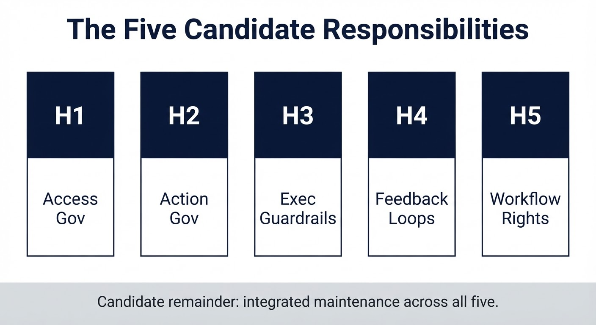
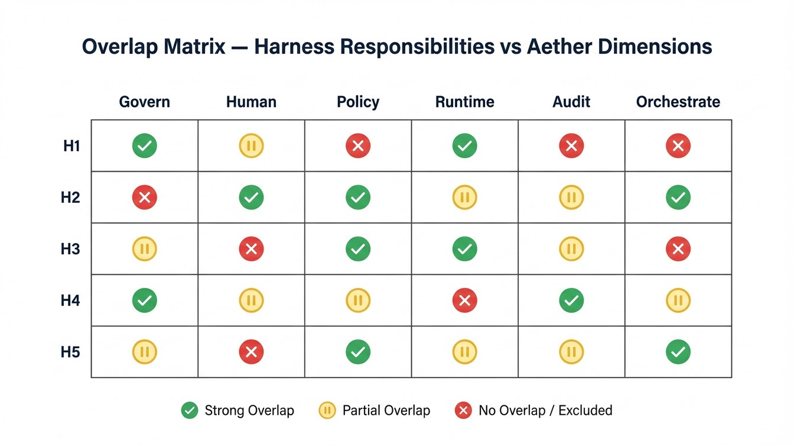
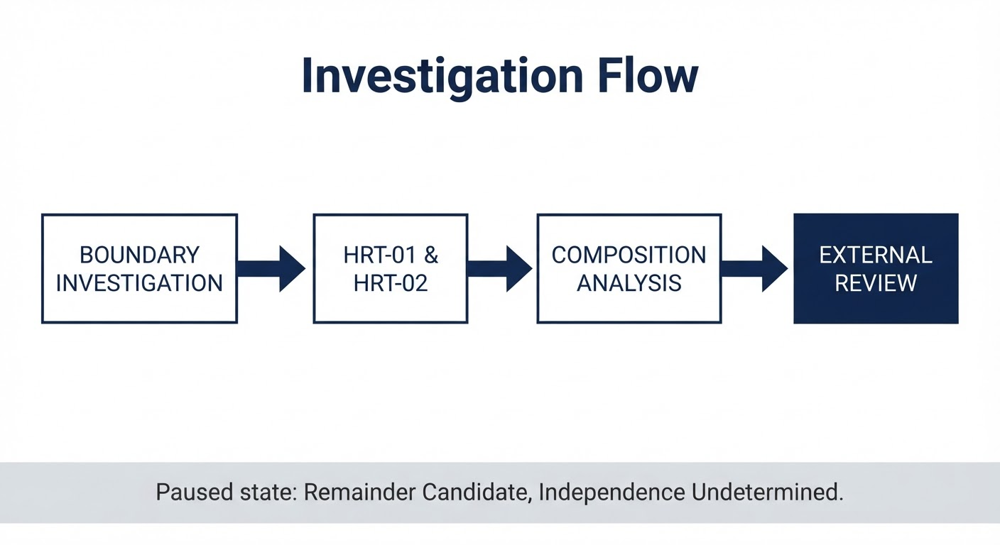
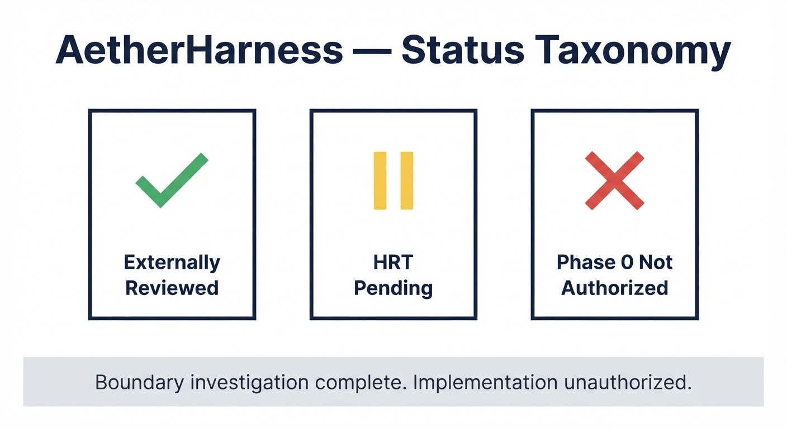

<div align="center">

# AetherHarness — Research Repository

### Integrated Operational Harness Integrity in Autonomous Multi-Agent Systems

*A Falsification-First Boundary Investigation of Responsibility Synchronization Across Aether Dimensions*

<br>

[](https://doi.org/10.5281/zenodo.24425655)
[](https://doi.org/10.6084/m9.figshare.35084839)
[](https://aether-harness.netlify.app)
[](https://creativecommons.org/licenses/by/4.0/)
[](https://orcid.org/0009-0003-8903-0029)


<br>

**[Website](https://aether-harness.netlify.app)** · **[Paper (PDF)](paper/AetherHarness_Research_Paper_v0.1.0.pdf)** · **[Zenodo](https://doi.org/10.5281/zenodo.24425655)** · **[Figshare](https://doi.org/10.6084/m9.figshare.35084839)** · **[Status](STATUS.md)** · **[Independent Review](REVIEW/INDEPENDENT_REVIEW.md)**

<br>

> ***"AetherHarness is a candidate, not a result."***

</div>

---

> [!IMPORTANT]
> **Status:** Boundary Investigation (Externally Reviewed — Recommendation (a)). This is a **research repository, not a software repository**. No implementation is authorized.
>
> **Decision:** **(E) Undetermined (interim).**
>
> **Structural dependency:** AetherHarness depends on the resolution of AetherGovern, AetherPolicy, AetherRuntime, AetherAudit, AetherOrchestrate and AetherHuman (each either foundational or a candidate).
>
> **Independent reviewer:** Jonathan Rabe (AI | ML Engineer), 2026-11-22.

---

## Table of Contents

- [Overview](#overview)
- [Central Question](#central-question)
- [The Five Candidate Responsibilities](#the-five-candidate-responsibilities)
- [Falsification Tests](#falsification-tests)
- [Propositions P1 and P2](#propositions-p1-and-p2)
- [Boundary Investigation Protocol](#boundary-investigation-protocol)
- [Independent Review](#independent-review)
- [Evaluation Design](#evaluation-design)
- [Decision](#decision)
- [Repository Structure](#repository-structure)
- [Investigation Status](#investigation-status)
- [What This Repository Does Not Claim](#what-this-repository-does-not-claim)
- [Related Work](#related-work)
- [Related Aether Projects](#related-aether-projects)
- [Threats to Validity](#threats-to-validity)
- [Citation](#citation)
- [Author](#author)
- [License](#license)

---

## Overview

**AetherHarness** is the **fourteenth project (candidate)** of the Aether family. It investigates whether a genuine architectural gap exists between **integrated operational harness integrity** — the synchronization of updates across responsibilities during a contextual transition — and the existing dimensions, in particular:

| Dimension | Concern |
|---|---|
| **AetherGovern** | Authority |
| **AetherHuman** | Oversight |
| **AetherPolicy** | Rules |
| **AetherRuntime** | Execution |

> **AetherHarness is not a replacement for any of these.** All remain dimensions or candidates with their own status. The investigation asks only whether synchronizing responsibility boundaries across transitions is a distinct responsibility that cannot be reduced to the existing dimensions.

This repository contains **no** `src/`, `tests/` or `experiments/`. It **does** contain a boundary investigation, two falsification tests (HRT-01, HRT-02) and an external review. The four figures of the paper are embedded below where they apply.

| | |
|---|---|
| **Current release** | v0.1.0 — [Zenodo](https://doi.org/10.5281/zenodo.24425655) · [Figshare](https://doi.org/10.6084/m9.figshare.35084839) |
| **Paper** | 34 pages · ~9,500 words · 30 references |
| **PDF in this repo** | [`paper/AetherHarness_Research_Paper_v0.1.0.pdf`](paper/AetherHarness_Research_Paper_v0.1.0.pdf) |
| **Website** | [aether-harness.netlify.app](https://aether-harness.netlify.app) |

---

## Central Question

> Is the composition of existing Aether dimensions sufficient to guarantee synchronization of updates across responsibilities during a contextual transition, or does an architectural remainder survive composition?

The question has four clauses, each mapped to a failure condition:

| Clause | Requirement | Condition |
|---|---|:-:|
| (i) | Not already covered by existing dimensions | **H-F1** |
| (ii) | Does not decompose into existing dimensions | **H-F2** |
| (iii) | No central harness authority required | **H-F3** |
| (iv) | Observable benefit | **H-F4** |

A positive answer needs **all four**. A negative answer on **any one** is sufficient to reject the candidate as a separate dimension.

---

## The Five Candidate Responsibilities

| ID | Responsibility | Primary overlap |
|:-:|---|---|
| **H1** | Access Governance | AetherGovern |
| **H2** | Action Governance | AetherGovern |
| **H3** | Execution Guardrails | AetherPolicy + AetherRuntime |
| **H4** | Feedback Loops | AetherRuntime + AetherAudit |
| **H5** | Workflow Decision Rights | AetherHuman *(most consequential)* |

These five are **not** assumed to be complete, independent or necessary.

<p align="center">
  
  <br>
  <sub><b>Figure 1.</b> The five candidate responsibilities (H1–H5) and their primary overlaps.</sub>
</p>

<p align="center">
  
  <br>
  <sub><b>Figure 2.</b> Overlap matrix: responsibilities H1–H5 against Aether dimensions.</sub>
</p>

---

## Falsification Tests

| ID | Test | Status |
|:-:|---|:-:|
| **HRT-01** | Representational Test | 🟡 **PENDING** |
| **HRT-01** | Maintenance Test | 🟡 **PENDING** |
| **HRT-02** | Compositional Synchronization Test | 🟡 **PENDING** |
| **HRT-02** | Composition Analysis | 🟡 **PENDING** |

> [!NOTE]
> **"PENDING" is not a pass.** It states that the test has been designed but that no final verdict has been issued.

**Decision rule:** the candidate is accepted as an independent dimension only if both tests are executed and neither is falsified. The current evidence does not meet that threshold, so the decision remains **(E) Undetermined (interim)**.

---

## Propositions P1 and P2

| # | Proposition | Status |
|:-:|---|:-:|
| **P1** | A synchronization transition between responsibilities is a deterministic function of the current responsibility state and the transition trigger. | Not tested |
| **P2** | Orchestration of tasks and synchronization of responsibility boundaries are distinct: a system can orchestrate correctly and still violate responsibility boundaries, and vice versa. | Not tested |

Neither proposition is machine-checked.

---

## Boundary Investigation Protocol

The boundary investigation is documented in [`RESEARCH/BOUNDARY_INVESTIGATION.md`](RESEARCH/BOUNDARY_INVESTIGATION.md). It identifies overlaps with existing Aether dimensions, records the risks of collapse, and states the questions HRT-01 must answer.

It is **not** a Phase 0 architectural hypothesis: it proposes no primitives, invariants or composition rules.

<p align="center">
  
  <br>
  <sub><b>Figure 3.</b> Investigation flow: Boundary → HRT-01/02 → Composition → External Review.</sub>
</p>

### Protocol — HRT-01 (Representational and Maintenance)

**Status:** 🟡 PENDING — see [`HRT-01_REPRESENTATIONAL_TEST.md`](FALSIFICATION/HRT-01_REPRESENTATIONAL_TEST.md) and [`HRT-01_MAINTENANCE_TEST.md`](FALSIFICATION/HRT-01_MAINTENANCE_TEST.md).

Tests whether the five responsibilities (H1–H5) are representable in the existing Aether dimensions, and whether their *integrated maintenance* across workflows is representable.

### Protocol — HRT-02 (Compositional Synchronization)

**Status:** 🟡 PENDING — see [`HRT-02_COMPOSITIONAL_SYNCHRONIZATION_TEST.md`](FALSIFICATION/HRT-02_COMPOSITIONAL_SYNCHRONIZATION_TEST.md) and [`HRT-02_COMPOSITION_ANALYSIS.md`](FALSIFICATION/HRT-02_COMPOSITION_ANALYSIS.md).

Tests whether the composition of existing Aether dimensions guarantees synchronization across responsibilities during contextual transitions.

---

## Independent Review

**Status:** ✅ **Completed** — signed by Jonathan Rabe (AI | ML Engineer) on 2026-11-22.

| | |
|---|---|
| **Recommendation** | **(a)** Confirm the current state: Boundary Investigation DRAFT / Author Declared, Remainder Candidate, Phase 0 Not Authorized, Decision (E) Undetermined. |
| **Independence declaration** | No stake in AetherHarness. No stake in any underlying Aether dimension. No conflict of interest. |
| **Full review** | [`REVIEW/INDEPENDENT_REVIEW.md`](REVIEW/INDEPENDENT_REVIEW.md) |
| **Protocol** | [`REVIEW/INDEPENDENT_REVIEW_PROTOCOL.md`](REVIEW/INDEPENDENT_REVIEW_PROTOCOL.md) |

---

## Evaluation Design

> [!NOTE]
> **Proposal, not executed.** This is a *design*, not a result.

The paper proposes six scenarios (S1–S6) and six metrics (M1–M6).

**Scenarios**

| ID | Scenario | What it tests |
|:-:|---|---|
| **S1** | Single-agent, single-responsibility | Baseline: one responsibility, one agent |
| **S2** | Single-agent, multi-responsibility | Does synchronization break across responsibilities within one agent? |
| **S3** | Multi-agent, single-responsibility | Does synchronization break across agents within one responsibility? |
| **S4** | Multi-agent, multi-responsibility | Does synchronization break at the intersection? |
| **S5** | Contextual transition | Does synchronization hold when the context changes? |
| **S6** | Adversarial transition | Does synchronization hold under adversarial conditions? |

**Metrics**

| ID | Metric | Type |
|:-:|---|---|
| **M1** | Responsibility boundary preservation rate | Quantitative |
| **M2** | Synchronization violation count | Quantitative |
| **M3** | Transition determinism | Qualitative |
| **M4** | Recovery from desynchronization | Quantitative |
| **M5** | Authority coherence across responsibilities | Qualitative |
| **M6** | Decision-right consistency across workflow steps | Qualitative |

---

## Decision

> ### AetherHarness is classified as **(E) Undetermined (interim)**.
> The evidence is insufficient to accept AetherHarness as an independent dimension, and insufficient to reject it.

| Why insufficient to **accept** | Why insufficient to **reject** |
|---|---|
| HRT-01 and HRT-02 are PENDING (no final verdict issued). | No failure condition has been falsified. |
| No implementation, no experiments. | The synchronization question is coherent. |
| Structural dependency on AetherGovern, AetherPolicy, AetherRuntime, AetherAudit, AetherOrchestrate and AetherHuman. | Partial functional coverage exists. |
| AetherHarness is a candidate, not a confirmed dimension. | The independent external review recommended (a) confirming the current state. |

**"Undetermined" is not a failure.** It states that the evidence is insufficient to decide, and names what is missing. Full record: [`STATUS.md`](STATUS.md).

<p align="center">
  
  <br>
  <sub><b>Figure 4.</b> Status taxonomy: Externally Reviewed, HRT Pending, Phase 0 Not Authorized.</sub>
</p>

---

## Repository Structure

```text
AetherHarness/
│
├── README.md
├── STATUS.md
├── CHANGELOG.md
├── AUTHORS.md
├── CONTRIBUTING.md
├── INVENTORY.md
├── CITATION.cff
├── VERSION
├── LICENSE
├── manifest.json
├── scientific_state.json
│
├── RESEARCH/
│   ├── BOUNDARY_INVESTIGATION.md
│   └── ARCHITECTURAL_HYPOTHESIS.md
│
├── FALSIFICATION/
│   ├── HRT-01_REPRESENTATIONAL_TEST.md
│   ├── HRT-01_MAINTENANCE_TEST.md
│   ├── HRT-02_COMPOSITIONAL_SYNCHRONIZATION_TEST.md
│   └── HRT-02_COMPOSITION_ANALYSIS.md
│
├── REVIEW/
│   ├── INDEPENDENT_REVIEW_PROTOCOL.md
│   └── INDEPENDENT_REVIEW.md
│
├── docs/
│   └── figures/
│       ├── Fig1_Status_Taxonomy.png
│       ├── Fig2_Overlap_Matrix.png
│       ├── Fig3_Investigation_Flow.png
│       └── Fig4_Five_Responsibilities.png
│
├── paper/
│   ├── AetherHarness_Research_Paper_v0.1.0.md
│   ├── AetherHarness_Research_Paper_v0.1.0.pdf
│   └── convert_to_pdf.py
│
└── PUBLICATION/
    └── Netlify/
        └── public/
```

No `src/`, no `tests/`, no `experiments/` — by design.

---

## Investigation Status

| Element | Status |
|---|:-:|
| Boundary Investigation | ✅ Author declared |
| External Review | ✅ Completed (Jonathan Rabe) |
| HRT-01 | 🟡 Pending |
| HRT-02 | 🟡 Pending |
| Individual-dimension coverage | 🟡 Partial (identified) |
| Complete synchronization coverage | ❌ Not identified |
| Compositional reconstruction | ⚠️ Insufficient evidence |
| Synchronization remainder | 🟡 Candidate |
| AetherHarness independence | ⚠️ Undetermined |
| Phase 0 | ❌ Not authorized |
| Implementation | ❌ Not authorized |
| **Decision** | 🟡 **(E) Undetermined** |

---

## What This Repository Does Not Claim

- ✖ That AetherHarness is an independent architectural dimension.
- ✖ That the five responsibilities (H1–H5) are complete, independent or necessary.
- ✖ That the boundaries with AetherGovern, AetherHuman, AetherPolicy and the other dimensions are sufficient.
- ✖ That the gap is genuine.
- ✖ That implementation should begin.
- ✖ Any observed benefit (HRT-01 and HRT-02 are pending).
- ✖ Any causal effect.
- ✖ Any specification of an interface, schema, protocol or prompt.

---

## Related Work

The paper cites the nearest neighbours as **reservations on H-F1**, not as support for the candidate.

| Area | References | Role |
|---|---|---|
| Distributed consensus | Lamport (1978); Fischer et al. (1985) | Background for synchronization |
| Coordination languages | Gelernter & Carriero (1992); Papadopoulos & Arbab (1998) | Background for composition |
| Workflow management | van der Aalst & van Hee (2004); Dumas et al. (2005) | Background for workflow state |
| Agent frameworks | AutoGen, LangGraph, CrewAI | Background for multi-agent orchestration |
| Responsible AI | Dignum (2019); Floridi & Cowls (2019) | Background for accountability |

The comparison with the field is treated as **open** and is a reservation on H-F1.

---

## Related Aether Projects

| # | Project | Status | DOI |
|:-:|---|:-:|---|
| 1 | AetherGit | Foundational | [10.5281/zenodo.23966896](https://doi.org/10.5281/zenodo.23966896) |
| 2 | AetherFlow | Foundational | [10.5281/zenodo.23979129](https://doi.org/10.5281/zenodo.23979129) |
| 3 | AetherProof | Foundational | [10.5281/zenodo.24013124](https://doi.org/10.5281/zenodo.24013124) |
| 4 | AetherMesh | Foundational | [10.5281/zenodo.24038038](https://doi.org/10.5281/zenodo.24038038) |
| 5 | AetherGovern | Foundational | [10.5281/zenodo.24054524](https://doi.org/10.5281/zenodo.24054524) |
| 6 | AetherRuntime | Foundational | [10.5281/zenodo.24078477](https://doi.org/10.5281/zenodo.24078477) |
| 7 | AetherOrchestrate | Foundational | [10.5281/zenodo.24095399](https://doi.org/10.5281/zenodo.24095399) |
| 8 | AetherIdentity | Candidate | [10.5281/zenodo.24150001](https://doi.org/10.5281/zenodo.24150001) |
| 9 | AetherPolicy | Candidate | [10.5281/zenodo.24274702](https://doi.org/10.5281/zenodo.24274702) |
| 10 | AetherAudit | Candidate | [10.5281/zenodo.24274628](https://doi.org/10.5281/zenodo.24274628) |
| 11 | AetherHuman | Candidate | [10.5281/zenodo.24406132](https://doi.org/10.5281/zenodo.24406132) |
| 12 | AetherMemory | Candidate | [10.5281/zenodo.24372288](https://doi.org/10.5281/zenodo.24372288) |
| 13 | AetherIntent | Candidate | [10.5281/zenodo.24417251](https://doi.org/10.5281/zenodo.24417251) |
| 14 | **AetherHarness** | Candidate *(this repository)* | [Zenodo](https://doi.org/10.5281/zenodo.24425655) · [Figshare](https://doi.org/10.6084/m9.figshare.35084839) |

---

## Threats to Validity

| # | Threat | Description |
|:-:|---|---|
| **T1** | Author-on-author reasoning | The hypothesis and the decision are written by the same author. |
| **T2** | Structural dependency on unresolved dimensions | AetherPolicy and AetherAudit are paused at Phase 4. |
| **T3** | The synchronization remainder may be semantic, not architectural | A semantic distinction may collapse into existing dimensions. |
| **T4** | Responsibility distinctions may be semantic, not architectural | H1 and H2 may collapse into AetherGovern. |
| **T5** | Decision-right maintenance may reduce to AetherHuman | H5 may be a use of AetherHuman, not a separate responsibility. |
| **T6** | No measurement | HRT-01 and HRT-02 are pending; no evaluation has been run. |
| **T7** | Related work may already cover the gap | The comparison with the field is open. |

---

## Citation

Machine-readable metadata is in [`CITATION.cff`](CITATION.cff), so GitHub shows a **"Cite this repository"** button.

```bibtex
@misc{baladi2026aetherharness,
  author    = {Baladi, Samir},
  title     = {AetherHarness: Integrated Operational Harness Integrity in Autonomous Multi-Agent Systems},
  year      = {2026},
  version   = {0.1.0},
  publisher = {Zenodo},
  doi       = {10.5281/zenodo.24425655},
  url       = {https://doi.org/10.5281/zenodo.24425655},
  note      = {Alternative DOI: https://doi.org/10.6084/m9.figshare.35084839; Boundary investigation; (E) Undetermined (interim)}
}
```

---

## Author

**Samir Baladi** — Interdisciplinary AI Researcher, Ronin Institute / Rite of Renaissance

| | |
|---|---|
| **Email** | [gitdeeper@gmail.com](mailto:gitdeeper@gmail.com) |
| **ORCID** | [0009-0003-8903-0029](https://orcid.org/0009-0003-8903-0029) |
| **Website** | [aether-harness.netlify.app](https://aether-harness.netlify.app) |
| **GitHub** | [gitdeeper15/aetherharness](https://github.com/gitdeeper15/aetherharness) |
| **GitLab** | [gitlab.com/gitdeeper15/aetherharness](https://gitlab.com/gitdeeper15/aetherharness) |
| **Codeberg** | [codeberg.org/gitdeeper15/aetherharness](https://codeberg.org/gitdeeper15/aetherharness) |
| **Bitbucket** | [bitbucket.org/gitdeeper15/aetherharness](https://bitbucket.org/gitdeeper15/aetherharness) |
| **Zenodo (v0.1.0, current)** | [10.5281/zenodo.24425655](https://doi.org/10.5281/zenodo.24425655) |
| **Figshare (alternative DOI)** | [10.6084/m9.figshare.35084839](https://doi.org/10.6084/m9.figshare.35084839) |

---

## License

**CC-BY-4.0** (this document) · **MIT** (code — future; none in this release).

---

<div align="center">

**AetherHarness v0.1.0** — Integrated Operational Harness Integrity

© 2026 Samir Baladi — Ronin Institute / Rite of Renaissance

Zenodo DOI (v0.1.0): [10.5281/zenodo.24425655](https://doi.org/10.5281/zenodo.24425655) · Figshare DOI: [10.6084/m9.figshare.35084839](https://doi.org/10.6084/m9.figshare.35084839)

*AetherHarness is a candidate, not a result.*

</div>
