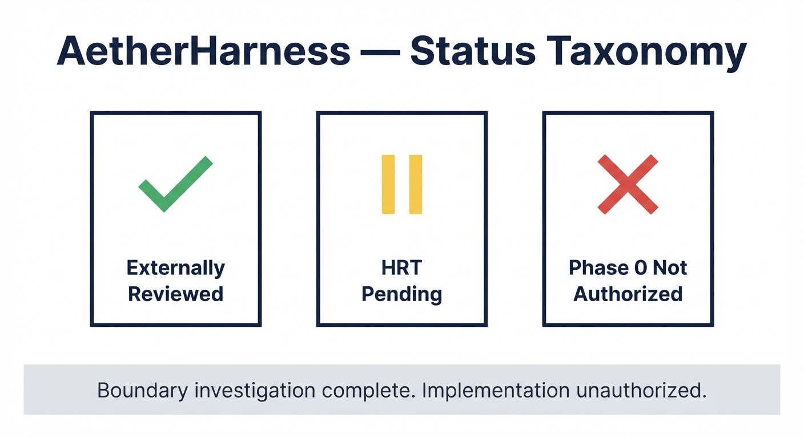
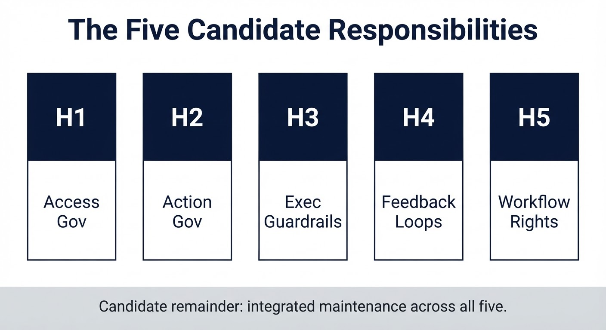
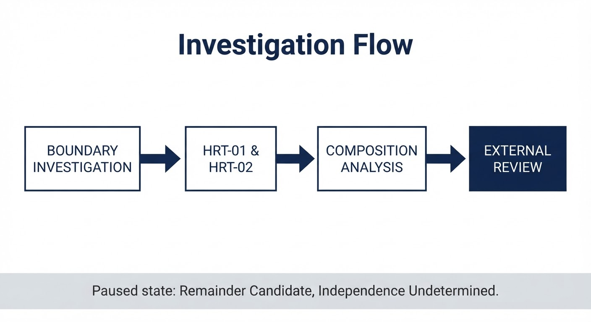

# Abstract

AetherHarness is the fourteenth candidate of the Aether family. It investigates a single boundary question: whether the composition of existing Aether dimensions — AetherGovern, AetherPolicy, AetherRuntime, AetherAudit, AetherOrchestrate, and AetherHuman — is sufficient to guarantee synchronization of updates across responsibilities during a contextual transition, or whether an architectural remainder survives composition. The investigation identifies five candidate responsibilities (H1–H5): Access Governance, Action Governance, Execution Guardrails, Feedback Loops, and Workflow Decision Rights. It records overlaps with existing dimensions, especially AetherHuman (candidate #11) and AetherGovern. Two falsification tests (HRT-01 and HRT-02) were designed but their final verdicts remain pending. The boundary investigation was authored, declared by the author, and independently reviewed by an external reviewer (Jonathan Rabe) on 2026-11-22, with recommendation (a): confirm the current state. The synchronization remainder is classified as a candidate, not a confirmed entity. AetherHarness independence is classified as undetermined. Phase 0 is not authorized, and implementation is not authorized. The decision is (E) Undetermined. AetherHarness is a candidate, not a result. It is structurally dependent on the resolution of AetherGovern, AetherPolicy, AetherRuntime, AetherAudit, AetherOrchestrate, and AetherHuman, all of which are either foundational or unresolved candidates.

**Keywords:** Aether family, boundary investigation, synchronization remainder, compositional reconstruction, falsification-first, architectural investigation, candidate #14, undetermined

---

# 1. Introduction

## 1.1 The Aether family and the fourteenth candidate

The Aether family is a set of architectural investigations into autonomous multi-agent systems. Its seven foundational dimensions are AetherGit, AetherFlow, AetherProof, AetherMesh, AetherGovern, AetherRuntime, and AetherOrchestrate. Its candidate dimensions include AetherIdentity (candidate #8), AetherPolicy (#9), AetherAudit (#10), AetherHuman (#11), AetherMemory (#12), AetherIntent (#13), and now AetherHarness (#14).

AetherHarness is not a foundational dimension. It is not a confirmed candidate dimension. It is a **boundary investigation**: a pre-Phase-0 test that asks whether an architectural remainder exists — a responsibility that is not already covered by the existing dimensions and that does not decompose into them.

The investigation is deliberately narrow. It does not propose a new architectural layer. It does not implement anything. It does not claim independence. It asks whether the existing dimensions, when composed, already guarantee synchronization across responsibilities during contextual transitions — or whether something survives composition.

## 1.2 Why harness is not orchestration, not policy, not execution

The term "harness" evokes several existing concepts. It is worth distinguishing them precisely.

**Orchestration** (AetherOrchestrate) concerns coordination of tasks: who does what, in what order, under what dependencies. It addresses sequencing, dependency resolution, and workflow dispatch. It does not address the *maintenance* of responsibility boundaries across workflow transitions.

**Policy** (AetherPolicy) concerns rules and enforcement: what is permitted, what is forbidden, under what conditions. It addresses the specification and enforcement of constraints. It does not address the *integration* of constraint enforcement across responsibilities when the context changes.

**Execution** (AetherRuntime) concerns the actual execution of actions: what runs, with what assurance, under what monitoring. It addresses runtime behavior and assurance. It does not address the *feedback* from execution outcomes into future decisions across responsibilities.

**Governance** (AetherGovern) concerns authority and delegation: who may access, who may act, under what scope. It addresses authority, delegation, revocation, and scope. It does not address the *maintenance* of access and action boundaries across contextual transitions.

**Audit** (AetherAudit) concerns records and evidence: what happened, when, and with what evidence. It addresses recording and evidence preservation. It does not address *feedforward* — the use of records to change future behavior across responsibilities.

**Human oversight** (AetherHuman) concerns human intervention and decision rights: who decides, within what bounds. It addresses oversight, bounded autonomy, and human decision rights. It does not address the *maintenance* of decision-right distributions across workflow evolution.

The AetherHarness investigation asks whether these distinctions are **architectural** — i.e., whether they correspond to a separate responsibility that none of the existing dimensions covers — or **operational** — i.e., whether they are uses of existing dimensions that do not require a new architectural layer.

## 1.3 Contribution and non-contribution

**Contribution.** This paper records a boundary investigation that:

1. Identifies five candidate responsibilities (H1–H5) that may or may not require a separate architectural layer.
2. Maps those responsibilities onto existing Aether dimensions and identifies the risks of collapse.
3. States two falsification tests (HRT-01 and HRT-02) whose final verdicts remain pending.
4. Reports an independent external review conducted by a reviewer who has no stake in the outcome.
5. Preserves a partial negative result: partial functional coverage exists, but complete synchronization coverage was not identified, and the compositional reconstruction remains insufficient.

**Non-contribution.** This paper does **not**:

1. Claim that AetherHarness is an independent architectural dimension.
2. Claim that a synchronization remainder is confirmed.
3. Claim that the existing Aether dimensions are insufficient.
4. Authorize Phase 0.
5. Authorize implementation.
6. Propose an API, a schema, a protocol, or a design.

The contribution is a **documented boundary**, not a constructed layer.

---

# 2. Related Work

## 2.1 Multi-agent synchronization and coordination

The problem of synchronizing state across multiple autonomous agents has been studied extensively in distributed systems literature. Foundational work on distributed consensus [1, 2] addresses agreement on shared state, but does not address the preservation of responsibility boundaries when the *context* of a workflow changes. Coordination languages [3, 4] address composition of agent behaviors, but do not distinguish between orchestration and the maintenance of responsibility integrity across transitions.

Multi-agent reinforcement learning [5, 6] addresses coordination in shared environments, but typically assumes a single optimization objective, not a set of distinct responsibilities whose boundaries must be maintained.

## 2.2 Workflow integrity and session state

Workflow management systems [7, 8] address execution of multi-step processes, but their state management focuses on data flow, not on responsibility boundaries. Session protocols [9] address state continuity across interactions, but not the integrity of responsibility assignments.

Business process modeling [10] distinguishes between orchestration and choreography, but does not address the boundary between existing architectural dimensions when responsibilities overlap.

## 2.3 Agent frameworks and responsibility composition

Contemporary agent frameworks (AutoGen [11], LangGraph [12], CrewAI [13]) implement orchestration, memory, and tool invocation, but they do not distinguish between the orchestration of tasks and the *maintenance* of responsibility integrity across contextual transitions. They provide mechanisms, not architectural distinctions.

The concept of "responsible AI" [14, 15] addresses accountability and oversight, but not the synchronization of responsibility boundaries.

## 2.4 Aether family and prior candidates

The Aether family has documented seven foundational dimensions and seven candidates. AetherHuman (candidate #11) investigates human oversight and bounded autonomy [16]. AetherMemory (candidate #12) investigates memory lifecycle integrity [17]. AetherIntent (candidate #13) investigates intent integrity in autonomous economic agents [18]. AetherHarness (candidate #14, this paper) investigates whether the composition of existing dimensions is sufficient to guarantee synchronization across responsibilities.

The relationships among these candidates are not resolved. AetherHarness is structurally dependent on the resolution of AetherGovern, AetherPolicy, AetherRuntime, AetherAudit, AetherOrchestrate, and AetherHuman. Any conclusion about AetherHarness is conditional on their resolution.

## 2.5 The gap (and why it is a research gap, not a blank space)

The gap addressed by AetherHarness is not a blank space in the literature. It is a **structured gap**: the existing dimensions and the existing literature address individual responsibilities (access, action, execution, feedback, decision rights), but they do not address whether *synchronization* across those responsibilities during contextual transitions is already covered by their composition, or whether it constitutes a separate responsibility.

This is a research gap in the sense that no existing work explicitly asks the composition question. It is not a blank space in the sense that the individual components are well-studied.

The investigation therefore begins by asking whether the composition question is meaningful, and ends by recording a partial negative result: partial coverage exists, but complete coverage was not identified, and the compositional reconstruction is insufficient.

---

# 3. The Aether Family Context

## Table 1 — The Aether family (14 candidates)

| # | Dimension | Type | Status |
|---|-----------|------|--------|
| 1 | AetherGit | Foundational | Reference |
| 2 | AetherFlow | Foundational | Reference |
| 3 | AetherProof | Foundational | Reference |
| 4 | AetherMesh | Foundational | Reference |
| 5 | AetherGovern | Foundational | Reference |
| 6 | AetherRuntime | Foundational | Reference |
| 7 | AetherOrchestrate | Foundational | Reference |
| 8 | AetherIdentity | Candidate | Phase 4 paused |
| 9 | AetherPolicy | Candidate | Phase 4 paused |
| 10 | AetherAudit | Candidate | Phase 4 paused |
| 11 | AetherHuman | Candidate | Phase 3 (interim) |
| 12 | AetherMemory | Candidate | Phase 0 (interim) |
| 13 | AetherIntent | Candidate | Phase 0 (interim) |
| 14 | **AetherHarness** | **Candidate** | **Boundary Investigation (EXTERNALLY REVIEWED)** |

AetherHarness is candidate #14. Its status is **Boundary Investigation**, which precedes Phase 0. The investigation has been externally reviewed, but Phase 0 is not authorized.

**Figure 1** (in `docs/figures/`) provides a visual overview of the family.

## Structural dependencies

AetherHarness is structurally dependent on six dimensions:

- **AetherGovern** — authority, delegation, revocation, scope.
- **AetherPolicy** — rules, enforcement, constraints.
- **AetherRuntime** — execution, assurance, monitoring.
- **AetherAudit** — records, evidence, provenance.
- **AetherOrchestrate** — workflow, coordination, dispatch.
- **AetherHuman** — oversight, bounded autonomy, decision rights.

Any conclusion about AetherHarness is conditional on the resolution of these six dimensions. AetherHarness cannot be established as independent while the overlaps with these dimensions remain unresolved.

---

# 4. Central Question and Scope

## 4.1 The central question

The central question of AetherHarness is:

> **Is the composition of existing Aether dimensions sufficient to guarantee synchronization of updates across responsibilities during a contextual transition, or does an architectural remainder survive composition?**

The question is deliberately narrow. It does not ask whether a harness is needed in general. It asks whether the *specific composition* of the *specific existing dimensions* already covers synchronization across responsibilities, or whether something survives.

## 4.2 Four clauses

The central question decomposes into four clauses, each of which must be addressed by the investigation:

**(i) Non-redundancy.** Is "integrated harness integrity" already covered by existing dimensions (Govern, Policy, Runtime, Audit, Orchestrate, Human)?

**(ii) Non-decomposability.** Does "integrated harness integrity" decompose into a composition of existing dimensions, or does it require a separate responsibility?

**(iii) Decentralizability.** Can harness integrity be maintained without a central authority?

**(iv) Observable benefit.** Would an independent harness produce an observable benefit over the composition of existing dimensions?

## 4.3 Scope

The investigation covers:

- Five candidate responsibilities (H1–H5).
- Six existing Aether dimensions (Govern, Policy, Runtime, Audit, Orchestrate, Human).
- Two falsification tests (HRT-01 and HRT-02).
- One compositional analysis.
- One independent external review.

The investigation does **not** cover:

- Implementation.
- API, schema, or protocol design.
- Experimental evaluation.
- Phase 0 authorization.
- A claim of independence.

The investigation is a **boundary test**, not an architectural proposal.

---

# 5. Architectural Hypothesis (Boundary Form)

## 5.1 Why this is not a standard hypothesis

A standard architectural hypothesis proposes primitives, invariants, and composition rules. AetherHarness does not do this. Phase 0 is not authorized, and no architectural content is claimed.

Instead, AetherHarness proposes a **boundary hypothesis**: a statement about what is *not* covered by existing dimensions. The hypothesis is conditional:

> *If* synchronization across responsibilities during contextual transitions is not covered by the composition of existing Aether dimensions, *then* an architectural remainder may survive composition.

The hypothesis is not asserted. It is tested by two falsification tests (HRT-01 and HRT-02) whose final verdicts remain pending.

## 5.2 Five candidate responsibilities

The investigation identifies five candidate responsibilities that may constitute the boundary:

### Table 2 — Five candidate responsibilities

| ID | Responsibility | Description | Primary overlap |
|:-:|---|---|---|
| **H1** | Access Governance | Control over what the agent can see and reach | AetherGovern |
| **H2** | Action Governance | Control over what the agent is allowed to do | AetherGovern |
| **H3** | Execution Guardrails | Constraints enforced during execution (budget, rate, forbidden sequences) | AetherPolicy + AetherRuntime |
| **H4** | Feedback Loops | Feeding execution outcomes back into review and improvement | AetherRuntime + AetherAudit |
| **H5** | Workflow Decision Rights | Distribution and maintenance of decision rights across multi-step workflows | AetherHuman (most consequential) |

## 5.3 The most consequential overlaps

Two existing dimensions are especially consequential:

**AetherHuman (candidate #11).** The overlap is most acute for H5 (Workflow Decision Rights). If AetherHuman's specification encompasses "maintenance of decision rights across multi-step workflows," then H5 collapses into AetherHuman. If it does not, H5 may constitute a remainder.

**AetherGovern.** The overlap is most acute for H1 (Access Governance) and H2 (Action Governance). If AetherGovern's specification encompasses "maintenance of access and action boundaries across contextual transitions," then H1 and H2 collapse into AetherGovern. If it does not, they may constitute a remainder.

## 5.4 The synchronization remainder (candidate)

The remainder, if it exists, is the **synchronization of updates across responsibilities during a contextual transition**.

It is not confirmed. It is a **candidate remainder**, for three reasons:

1. The texts of existing dimensions are silent on synchronization, not because synchronization is absent.
2. A composition may exist that is not obvious from the texts alone.
3. Further evidence (from external literature or future Aether papers) could change the conclusion.

The remainder is therefore stated as a candidate, not as a confirmed entity.

## 5.5 The documented absence

The file `RESEARCH/ARCHITECTURAL_HYPOTHESIS.md` is a **documented absence**. It states explicitly that:

- No architectural hypothesis has been formulated.
- Phase 0 is not authorized.
- The file will remain empty of architectural content until the preconditions for Phase 0 are satisfied.

This is not a placeholder. It is a deliberate, documented absence, consistent with the falsification-first methodology of the Aether family.

**Figure 2** (in `docs/figures/`) provides a visual overview of the five candidate responsibilities and their overlaps.

---

# 6. Falsification Methodology

## 6.1 The falsification-first principle

AetherHarness follows the falsification-first methodology used in AetherHuman and AetherGovern. The principle is:

> A candidate is not accepted because it has not been falsified. It is accepted only when a stated failure condition has been falsified, and only when the failure condition is sufficiently strong to rule out alternative explanations.

The methodology distinguishes three states:

- **Untested** — a failure condition has not been tested.
- **Pending** — a test has been designed but its final verdict has not been issued.
- **Falsified / Survives (interim)** — the failure condition has been either falsified (the claim fails) or has survived an interim test (the claim has not failed, but has not been confirmed either).

## 6.2 Two falsification tests

The investigation designs two falsification tests:

**HRT-01 — Harness Representational Test.** Tests whether the five responsibilities (H1–H5) are representable in existing Aether dimensions, and whether their *integrated maintenance* across workflows is representable. Two sub-tests: representational test and maintenance test.

**HRT-02 — Compositional Synchronization Test.** Tests whether the composition of existing Aether dimensions guarantees synchronization across responsibilities during contextual transitions. Two sub-tests: compositional test (across multiple dimensions) and composition analysis (whether composition itself provides synchronization).

## 6.3 Final verdicts

Both HRT-01 and HRT-02 have been designed and documented, but their final verdicts remain **pending**. The investigation does not issue a "falsified" verdict for either test, and does not issue a "survives" verdict that would authorize Phase 0.

This is deliberate. The investigation is a boundary test, not an authorization test. Its purpose is to identify whether the boundary *may* exist, not to authorize Phase 0.

## 6.4 Decision rule

The decision rule for the investigation is:

- If both tests survive with confirmed evidence, Phase 0 may be authorized (not yet the case).
- If either test is falsified with confirmed evidence, the candidate is closed (not yet the case).
- If either test is pending, the candidate remains a boundary investigation (current state).

The current state is the third case: both tests are pending, and the candidate remains a boundary investigation.

**Figure 3** (in `docs/figures/`) shows the investigation flow.

---

# 7. Propositions P1–P2

## 7.1 P1 — Determinism of synchronization transitions

**Statement.** A synchronization transition between responsibilities is a deterministic function of the current responsibility state and the transition trigger.

**Status.** Not machine-checked. Not tested.

**Reasoning.** If the transition is deterministic, then it can in principle be verified without a central authority. If the transition is non-deterministic, then either a central authority is required to resolve ambiguity, or the system must tolerate multiple possible transitions.

The proposition is a hypothesis about the nature of synchronization. It is stated so that it can be falsified: a counterexample is a system in which two identical responsibility states and identical triggers produce different transitions.

## 7.2 P2 — Irreducible distinction between orchestration and synchronization

**Statement.** Orchestration of tasks and synchronization of responsibility boundaries are distinct: a system can orchestrate correctly and still violate responsibility boundaries, and vice versa.

**Status.** Not machine-checked. Not tested.

**Reasoning.** If the distinction is not irreducible — i.e., if orchestration implies synchronization, or if synchronization implies orchestration — then the harness remainder collapses into AetherOrchestrate. The proposition is stated so that it can be falsified: a counterexample is a system in which correct orchestration guarantees responsibility synchronization, or vice versa.

## 7.3 What P1 and P2 are not

Neither P1 nor P2 is an architectural claim. They are **hypotheses whose truth would bear on whether the harness remainder is architectural or operational**. They are stated in falsifiable form so that future work can test them.

---

# 8. Decision (Phase 0)

## 8.1 Current decision

**(E) Undetermined (interim).**

The decision is not (A) Accept, because:

- All four failure conditions (H-F1 through H-F4) are untested or pending.
- No implementation and no experiments exist.
- The investigation is structurally dependent on AetherGovern, AetherPolicy, AetherRuntime, AetherAudit, AetherOrchestrate, and AetherHuman, all of which are either foundational or unresolved candidates.
- AetherHarness is a candidate, not a confirmed dimension.

The decision is not (B) Reject, because:

- No failure condition has been falsified.
- The synchronization question is coherent.
- Partial functional coverage exists across existing dimensions.
- Related work exists (distributed consensus, coordination languages, agent frameworks).
- The candidate has been independently reviewed and the reviewer recommended (a) confirming the current state.

## 8.2 What "interim" means

The decision is **interim**, not final. It reflects the current state of evidence. If new evidence becomes available (a new Aether paper addressing synchronization, new external literature, new compositional evidence), the decision may change.

The interim decision is recorded in `scientific_state.json` and `STATUS.md`, and is preserved as the official state until reopening conditions are met.

## 8.3 Decision codes

The Aether family uses five decision codes:

- **(A) Accept** — the candidate is accepted as a dimension.
- **(B) Reject** — the candidate is rejected.
- **(C) Revise** — the candidate is revised and retested.
- **(D) Defer** — the candidate is deferred pending external evidence.
- **(E) Undetermined** — the candidate is undetermined; the investigation remains open.

AetherHarness is (E) Undetermined (interim).

**Figure 4** (in `docs/figures/`) shows the investigation status taxonomy.

---

# 9. Evaluation Design (Proposal, Not Executed)

## 9.1 Why an evaluation design is proposed

Even though no experiments have been executed, an evaluation design is recorded so that, if Phase 0 is eventually authorized, the evaluation can proceed without ad hoc construction. The design is a **proposal**, not an execution. It does not authorize implementation.

## 9.2 Evaluation scenarios (S1–S6)

| ID | Scenario | Purpose |
|:-:|---|---|
| **S1** | Single-agent single-responsibility workflow | Baseline: single responsibility, single agent |
| **S2** | Single-agent multi-responsibility workflow | Does synchronization break across responsibilities within a single agent? |
| **S3** | Multi-agent single-responsibility workflow | Does synchronization break across agents within a single responsibility? |
| **S4** | Multi-agent multi-responsibility workflow | Does synchronization break at the intersection? |
| **S5** | Contextual transition (responsibility shift) | Does synchronization hold when the context changes? |
| **S6** | Adversarial transition (forced responsibility conflict) | Does synchronization hold under adversarial conditions? |

## 9.3 Evaluation metrics (M1–M6)

| ID | Metric | Type |
|:-:|---|---|
| **M1** | Responsibility boundary preservation rate | Quantitative |
| **M2** | Synchronization violation count | Quantitative |
| **M3** | Transition determinism | Qualitative |
| **M4** | Recovery from desynchronization | Quantitative |
| **M5** | Authority coherence across responsibilities | Qualitative |
| **M6** | Decision-right consistency across workflow steps | Qualitative |

## 9.4 What the design does not establish

The design does not establish that a synchronization remainder exists. It establishes only that, **if** a remainder exists, it can in principle be measured. The design is a **precondition for future work**, not evidence for the current decision.

The design is recorded here because it is a contribution of the boundary investigation: it makes the investigation *falsifiable in principle*, even when it is not yet falsifiable in practice.
---

# 10. Threats to Validity

The investigation records seven threats to validity. They are not weaknesses to be hidden; they are structural constraints of the current evidence base.

## Table 3 — Threats to validity (T1–T7)

| ID | Threat | Severity |
|:-:|---|:-:|
| **T1** | Author-on-author reasoning (the investigation is conducted by the author of AetherHarness, without external construction) | High |
| **T2** | Structural dependency on unresolved dimensions (AetherPolicy and AetherAudit are both paused at Phase 4) | High |
| **T3** | The synchronization remainder may be semantic, not architectural | Medium |
| **T4** | Responsibility distinctions may be semantic, not architectural (e.g., H1 and H2 may collapse into AetherGovern) | Medium |
| **T5** | Decision-right maintenance may reduce to AetherHuman | Medium |
| **T6** | No measurement (no implementation, no experiments) | High |
| **T7** | Related work may already cover the gap | Medium |

## 10.1 T1 — Author-on-author reasoning

The investigation is conducted by the author of AetherHarness. It is not conducted by an independent party. This is not fully mitigated by the external review (see Section 10.8), because the external reviewer reads the author's framing, not the author's working process.

**Mitigation.** The investigation documents this threat explicitly in `STATUS.md` and in this paper. The external review (Jonathan Rabe, 2026-11-22) is an independent assessment, but it is an assessment of the *written* investigation, not of the *process*.

## 10.2 T2 — Structural dependency on unresolved dimensions

AetherHarness is structurally dependent on AetherGovern, AetherPolicy, AetherRuntime, AetherAudit, AetherOrchestrate, and AetherHuman. Any conclusion about AetherHarness is conditional on their resolution.

**Mitigation.** The investigation records this dependency explicitly. It does not claim independence. It does not claim that the existing dimensions are insufficient. It records a partial negative result: partial coverage exists, but complete coverage was not identified.

## 10.3 T3 — The synchronization remainder may be semantic, not architectural

The synchronization remainder may be a semantic distinction, not an architectural one. If synchronization across responsibilities can be fully expressed as a use of existing dimensions (Govern, Policy, Runtime, Audit, Orchestrate, Human), then it collapses into them.

**Mitigation.** The investigation states the remainder as a **candidate**, not as a confirmed entity. It records that the composition question is open.

## 10.4 T4 — Responsibility distinctions may be semantic, not architectural

The five responsibilities (H1–H5) may be restatements of existing dimensions, not separate responsibilities. For example, H1 (Access Governance) and H2 (Action Governance) may both reduce to AetherGovern.

**Mitigation.** The investigation records the risks of collapse explicitly in `RESEARCH/BOUNDARY_INVESTIGATION.md`. It does not claim that H1–H5 are architectural.

## 10.5 T5 — Decision-right maintenance may reduce to AetherHuman

H5 (Workflow Decision Rights) may be a use of AetherHuman, not a separate responsibility. If AetherHuman's specification encompasses cross-step maintenance of decision rights, then H5 collapses.

**Mitigation.** The investigation identifies AetherHuman as the most consequential overlap and records the risk of collapse explicitly.

## 10.6 T6 — No measurement

The investigation has no implementation, no experiments, and no measurement. The verdicts of HRT-01 and HRT-02 remain pending.

**Mitigation.** The investigation records this explicitly. It does not claim any empirical result. It records an evaluation design (Section 9) as a proposal for future work.

## 10.7 T7 — Related work may already cover the gap

Related work in distributed systems, workflow management, and agent frameworks may already cover the synchronization question.

**Mitigation.** The investigation is conditional: if related work covers the gap, the candidate closes. The investigation does not claim to be novel. It claims only that the composition question is open.

## 10.8 Note on external review

The investigation was externally reviewed by Jonathan Rabe (AI | ML Engineer) on 2026-11-22. The review was conducted under `REVIEW/INDEPENDENT_REVIEW_PROTOCOL.md`. The reviewer declared:

- No stake in AetherHarness.
- No stake in any underlying Aether dimension.
- No conflict of interest.

The reviewer's recommendation was **(a): confirm the current state**.

The external review does **not** eliminate T1 (author-on-author reasoning). It mitigates T1 by introducing an independent assessment of the written investigation, but it does not eliminate the fact that the investigation was conducted by the author.

---

# 11. Discussion

## 11.1 What "Phase 0" means

Phase 0 (Architectural Hypothesis) is the phase in which a candidate transitions from a boundary investigation to a proposed architectural layer. Phase 0 requires:

- A documented boundary investigation.
- Stated failure conditions.
- A falsification plan.
- A provisional architectural hypothesis.

AetherHarness is **not in Phase 0**. It is in a **boundary investigation**, which precedes Phase 0. The boundary investigation is complete (author-declared and externally reviewed), but Phase 0 is not authorized.

The distinction is important. A boundary investigation asks whether a boundary exists. Phase 0 asks what the architecture on the other side of the boundary would be. These are different questions.

## 11.2 The boundary with AetherGit (storage vs lifecycle)

AetherGit concerns storage and versioning: commits, history, branching. AetherHarness, if it exists as an independent responsibility, concerns synchronization of responsibilities across transitions, not storage.

The distinction is **temporal**: AetherGit preserves state across time; AetherHarness synchronizes state across responsibilities at a point in time. Whether this distinction is architectural or operational is not resolved by the current investigation.

## 11.3 The boundary with AetherMesh (consistency vs coherence)

AetherMesh concerns consistency: agreement on shared state across nodes. AetherHarness, if it exists, concerns **coherence across responsibilities**, not consistency across nodes.

The distinction is **dimensional**: AetherMesh synchronizes state across space (nodes); AetherHarness synchronizes state across responsibility boundaries. Whether this distinction is architectural or operational is not resolved by the current investigation.

## 11.4 The boundary with AetherPolicy (lifecycle policy vs lifecycle integrity)

AetherPolicy concerns rules and enforcement: what is permitted, under what conditions. AetherHarness, if it exists, concerns the **integration** of constraint enforcement across responsibilities, not the specification of constraints.

The distinction is **integrational**: AetherPolicy specifies rules; AetherHarness maintains their integration across changing contexts. Whether this distinction is architectural or operational is not resolved by the current investigation.

## 11.5 The boundary with AetherAudit (recording vs semantics)

AetherAudit concerns records and evidence: what happened, with what evidence. AetherHarness, if it exists, concerns **feedforward** from records to behavior across responsibilities, not the recording itself.

The distinction is **directional**: AetherAudit records what happened; AetherHarness uses what happened to synchronize responsibilities across future transitions. Whether this distinction is architectural or operational is not resolved by the current investigation.

## 11.6 What remains open

The four boundaries (Git, Mesh, Policy, Audit) are **open**. They are not resolved. Each of them could be the site of a collapse of AetherHarness into an existing dimension.

The investigation records them as open. It does not claim that any of them is resolved.

---

# 12. Conclusion

AetherHarness investigates a single boundary question: whether the composition of existing Aether dimensions is sufficient to guarantee synchronization across responsibilities during a contextual transition, or whether an architectural remainder survives composition.

The investigation has identified five candidate responsibilities (H1–H5), mapped them onto existing Aether dimensions, recorded risks of collapse, designed two falsification tests (HRT-01 and HRT-02), and conducted an external review. The verdicts of the falsification tests remain pending.

The synchronization remainder is classified as a **candidate**, not a confirmed entity. AetherHarness independence is classified as **undetermined**. Phase 0 is **not authorized**. Implementation is **not authorized**. The decision is **(E) Undetermined (interim)**.

The investigation is paused, not closed. It can be reopened if new evidence becomes available: a new Aether paper addressing synchronization, new external literature, new compositional evidence, or new evidence on AetherHarness independence.

AetherHarness is a candidate, not a result. Its independence is not established, and it is structurally dependent on AetherGovern, AetherPolicy, AetherRuntime, AetherAudit, AetherOrchestrate, and AetherHuman, all of which are either foundational or unresolved candidates. Any conclusion about AetherHarness is conditional on their resolution.

**AetherHarness is a candidate, not a result.**

---

# Acknowledgements

The author thanks Jonathan Rabe (AI | ML Engineer) for conducting the independent external review and for identifying the H3/H4 naming inconsistency in the README. The author also thanks the broader Aether family context for the falsification-first methodology, without which this investigation would not have been possible.

The author thanks the Ronin Institute / Rite of Renaissance for institutional support.

---

# References

[1] Lamport, L. (1978). Time, clocks, and the ordering of events in a distributed system. *Communications of the ACM*, 21(7), 558–565.

[2] Fischer, M. J., Lynch, N. A., & Paterson, M. S. (1985). Impossibility of distributed consensus with one faulty process. *Journal of the ACM*, 32(2), 374–382.

[3] Gelernter, D., & Carriero, N. (1992). Coordination languages and their significance. *Communications of the ACM*, 35(2), 97–107.

[4] Papadopoulos, G. A., & Arbab, F. (1998). Coordination models and languages. *Advances in Computers*, 46, 329–400.

[5] Foerster, J. N., Assael, Y. M., de Freitas, N., & Whiteson, S. (2016). Learning to communicate with deep multi-agent reinforcement learning. In *Advances in Neural Information Processing Systems*, 29.

[6] Lowe, R., Wu, Y., Tamar, A., Harb, J., Abbeel, P., & Mordatch, I. (2017). Multi-agent actor-critic for mixed cooperative-competitive environments. In *Advances in Neural Information Processing Systems*, 30.

[7] van der Aalst, W. M. P., & van Hee, K. M. (2004). *Workflow Management: Models, Methods, and Systems*. MIT Press.

[8] Dumas, M., van der Aalst, W. M. P., & ter Hofstede, A. H. M. (2005). *Process-Aware Information Systems*. Wiley.

[9] Fielding, R. T. (2000). *Architectural Styles and the Design of Network-Based Software Architectures*. Doctoral dissertation, University of California, Irvine.

[10] Peltz, C. (2003). Web services orchestration and choreography. *Computer*, 36(10), 46–52.

[11] Wu, Q., Bansal, G., Zhang, J., Wu, X., Li, B., Zhu, E., ... & Wang, C. (2023). AutoGen: Enabling next-gen LLM applications via multi-agent conversation. *arXiv preprint arXiv:2308.08155*.

[12] LangChain Inc. (2024). *LangGraph: Building Stateful Multi-Agent Applications*. Technical Documentation.

[13] CrewAI Inc. (2024). *CrewAI: Framework for Orchestrating Role-Playing AI Agents*. Technical Documentation.

[14] Dignum, V. (2019). *Responsible Artificial Intelligence: How to Develop and Use AI in a Responsible Way*. Springer.

[15] Floridi, L., & Cowls, J. (2019). A unified framework of five principles for AI in society. *Harvard Data Science Review*, 1(1).

[16] Baladi, S. (2026). AetherHuman: Human Oversight Integrity in Autonomous Multi-Agent Systems (v3.0.0). DOI: 10.5281/zenodo.24406132.

[17] Baladi, S. (2026). AetherMemory: Memory Lifecycle Integrity in Autonomous Multi-Agent Systems (v0.1.0). DOI: 10.5281/zenodo.24372288.

[18] Baladi, S. (2026). AetherIntent: Intent Integrity in Autonomous Economic Agent Systems (v1.0.0). DOI: 10.5281/zenodo.24417251.

[19] Baladi, S. (2026). AetherGovern: Authority Integrity in Autonomous Multi-Agent Systems (v0.1.0). DOI: 10.5281/zenodo.24256617.

[20] Baladi, S. (2026). AetherPolicy: Rule Integrity in Autonomous Multi-Agent Systems (v0.1.0). DOI: 10.5281/zenodo.24274702.

[21] Baladi, S. (2026). AetherAudit: Evidence Integrity in Autonomous Multi-Agent Systems (v0.1.0). DOI: 10.5281/zenodo.24274628.

[22] Baladi, S. (2026). AetherIdentity: Identity Integrity in Autonomous Multi-Agent Systems (v0.1.0). DOI: 10.5281/zenodo.24150001.

[23] Herlihy, M., & Wing, J. M. (1990). Linearizability: A correctness condition for concurrent objects. *ACM Transactions on Programming Languages and Systems*, 12(3), 463–492.

[24] Shapiro, M., Preguiça, N., Baquero, C., & Zawirski, M. (2011). Conflict-free replicated data types. In *Symposium on Self-Stabilizing Systems*, 386–400.

[25] De Nicola, R., & Ferrari, G. (2016). *Coordination Models and Languages*. Springer.

[26] Wooldridge, M. (2009). *An Introduction to MultiAgent Systems* (2nd ed.). Wiley.

[27] Shoham, Y., & Leyton-Brown, K. (2008). *Multiagent Systems: Algorithmic, Game-Theoretic, and Logical Foundations*. Cambridge University Press.

[28] Popper, K. R. (1959). *The Logic of Scientific Discovery*. Hutchinson.

[29] Lakatos, I. (1976). Falsification and the methodology of scientific research programmes. In *Criticism and the Growth of Knowledge*, 91–196.

[30] Mayo, D. G. (1996). *Error and the Growth of Experimental Knowledge*. University of Chicago Press.

---

# Appendix A — The Aether family (14 projects)

| # | Dimension | Type | DOI |
|---|-----------|------|-----|
| 1 | AetherGit | Foundational | [Reference] |
| 2 | AetherFlow | Foundational | [Reference] |
| 3 | AetherProof | Foundational | [Reference] |
| 4 | AetherMesh | Foundational | [Reference] |
| 5 | AetherGovern | Foundational | [Reference] |
| 6 | AetherRuntime | Foundational | [Reference] |
| 7 | AetherOrchestrate | Foundational | [Reference] |
| 8 | AetherIdentity | Candidate | 10.5281/zenodo.24150001 |
| 9 | AetherPolicy | Candidate | 10.5281/zenodo.24274702 |
| 10 | AetherAudit | Candidate | 10.5281/zenodo.24274628 |
| 11 | AetherHuman | Candidate | 10.5281/zenodo.24406132 |
| 12 | AetherMemory | Candidate | 10.5281/zenodo.24372288 |
| 13 | AetherIntent | Candidate | 10.5281/zenodo.24417251 |
| 14 | **AetherHarness** | **Candidate** | **10.5281/zenodo.24425655** |

# Appendix B — Glossary

- **Boundary investigation.** A pre-Phase-0 investigation that tests whether an architectural remainder exists beyond the composition of existing dimensions.
- **Candidate.** A dimension under investigation. Not confirmed.
- **Compositional reconstruction.** The process of determining whether the composition of existing dimensions covers a proposed responsibility.
- **Decision code (E) Undetermined.** The Aether family code for "not accepted, not rejected, still under investigation."
- **Falsification-first.** A methodology in which a claim is accepted only when a stated failure condition has been falsified, not merely when it has not been falsified.
- **Phase 0.** The phase in which a candidate transitions from boundary investigation to proposed architectural hypothesis.
- **Remainder.** A responsibility that survives composition of existing dimensions.
- **Synchronization.** The maintenance of consistent responsibility boundaries across contextual transitions.

# Appendix C — Change log

## v0.1.0 — 2026-11-22 (initial release)

- Boundary investigation authored and declared.
- HRT-01 and HRT-02 designed (verdicts pending).
- External review completed by Jonathan Rabe (2026-11-22).
- Recommendation (a): confirm the current state.
- Phase 0: NOT AUTHORIZED.
- Implementation: NOT AUTHORIZED.

**AetherHarness is a candidate, not a result.**
